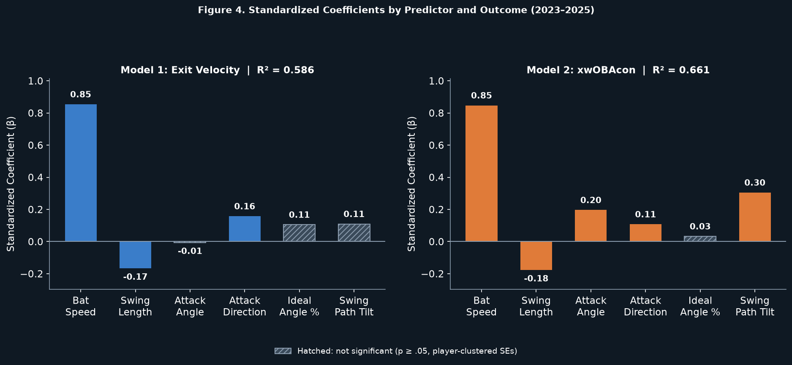

# Swing Kinematics & Contact Quality

Sport analytics capstone: how six swing kinematics predict contact quality in MLB hitters.

Uses Statcast bat-tracking data for all qualified hitters from 2023-2025 (408 player-seasons, 219 unique hitters). Bat speed, swing length, attack angle, attack direction, ideal attack angle rate, and swing path tilt are used to predict two outcomes — average exit velocity and expected weighted on-base average on contact (xwOBAcon) — via multiple linear regression with season fixed effects and standard errors clustered by player.

Bat speed is the dominant predictor of both outcomes: dropping it alone costs about 45 points of R², while no other kinematic costs more than 5. Swing path tilt and attack angle matter for whether hard contact turns into run value but contribute little to raw exit velocity. They stay significant for xwOBAcon even with exit velocity held fixed, which suggests swing plane governs *where* the ball goes more than *how hard* it leaves the bat. The results hold under player-grouped cross-validation (out-of-fold R² .535 and .624, compared with .586 and .661 in-sample), a random-intercept mixed model, and refits without the partially tracked 2023 season or influential points.



## Contents

- **`writeup.pdf`**: the capstone as submitted in 2025.
- **`docs/ADDENDUM.md`**: robustness checks added after submission, with methods, results and limitations.
- **`output/robustness_report.md`**: generated tables for every robustness check, with the data pull date and file hash.
- **`output/figures/`**: the four figures.
- **`swing_kinematics_model.py`**: entry point. Covers data loading, descriptives, the two player-clustered OLS models, diagnostics (VIF, condition number, Shapiro-Wilk, Breusch-Pagan, Cook's D), figures, and the report.
- **`report.py`**: builds the robustness report: HC3 vs. clustered SEs, ΔR², player-grouped CV, mixed model, sensitivity refits, nonlinearity, Model 3 (xwOBAcon controlling for exit velocity) and Holm-adjusted p-values.
- **`robustness.py`**, **`figures.py`**, **`config.py`**: statistical helpers, plotting, and shared settings.
- **`get_data.py`**: downloads the dataset from Baseball Savant, records the pull date, and prints tracked-swing coverage for the sample.
- **`tests/`**: unit and end-to-end tests on synthetic data (no download needed), which CI runs on every push.

## Reproduce

```bash
python -m venv .venv
.venv/Scripts/activate        # Windows; use `source .venv/bin/activate` on macOS/Linux
pip install -r requirements-dev.txt
python get_data.py
python swing_kinematics_model.py
pytest
```

Use `requirements.txt` instead of `requirements-dev.txt` if you only want to run the analysis.

## Data

`get_data.py` pulls Baseball Savant's [custom leaderboard](https://baseballsavant.mlb.com/leaderboard/custom) for qualified batters (`type=batter&min=q`), one request per season for 2023, 2024 and 2025. It requests the fields `avg_swing_speed, avg_swing_length, attack_angle, attack_direction, ideal_angle_rate, vertical_swing_path, exit_velocity_avg, xwobacon`, then stacks the three seasons into `Swing_Metrics_2023-2025.csv`. The CSV is not redistributed in this repo. Its pull date is committed in `Swing_Metrics_2023-2025.meta.json`.

Bat tracking was rolled out during 2023. In this sample, 2023 player-seasons rest on a median of 432 tracked competitive swings (minimum 168), compared with 950 in 2024 and 952 in 2025. Savant revises its data occasionally, so a fresh pull can differ slightly from `writeup.pdf` and from the committed report. Compare the SHA-256 in the report to confirm you have the same file.

## Tech stack

Python, `pandas`, `scipy`, `statsmodels`, `scikit-learn`, `matplotlib`.

## License

Code is MIT-licensed (see `LICENSE`). The write-up (`writeup.pdf`) is © Henry Bednar, all rights reserved.
